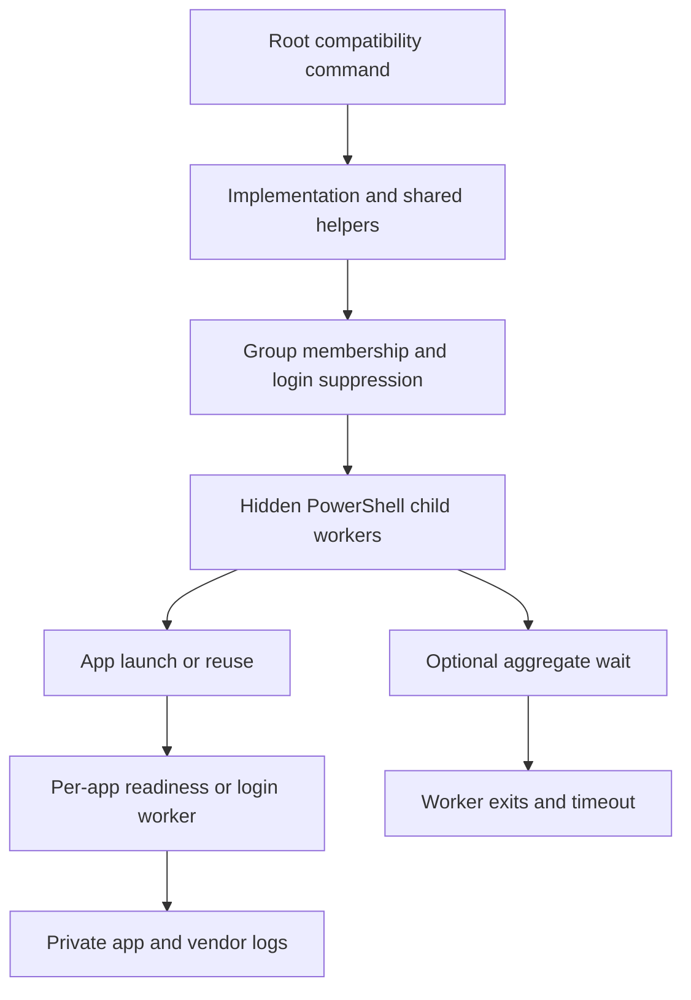

# Architecture and maintenance

[Documentation home](../README.md) · [Setup](setup.md) · [Testing](testing.md)

## Stable entry points, organized implementations

Root `.ps1` files are compatibility entry points, not duplicate business logic. `config/entrypoints.psd1` maps them to implementations in `scripts/` or reusable helpers in `src/`. Root `common.ps1`, `ui-input.ps1`, and `window-util.ps1` remain dot-source bridges. Existing scheduler actions, shortcuts, manual commands, and local diagnostic scripts therefore retain their paths.

`tools/Sync-EntryPoints.ps1` copies implementation parameter declarations into command wrappers and forwards `@PSBoundParameters` and positional arguments. Wrappers convert uncaught errors and failed script exits to nonzero command exits. Use `-Check` to detect stale generated wrappers without editing files.

`src/common.ps1` computes the repository root from its own location, imports shared helpers, and defines legacy defaults. It does not create directories, read credentials, query processes, or connect to API ports while importing. Native UI helpers compile types when explicitly loaded; no window actions run just from loading the shared helpers.

## Responsibilities

- `src/process-runner.ps1`: allowed command dispatch, quoting, process polling, aggregate waits, exact IBC entry-point matching, API-listener ownership, version/workbook discovery.
- `src/credentials.ps1`: DPAPI retrieval, 1Password fallback, exact field selection, Java Properties escaping, restricted atomic file publication.
- `src/ui-input.ps1`: screen fingerprints and guarded native input. Application-specific state machines remain in `scripts/login/`; they are not forced into one generic algorithm.
- `src/obs.ps1`: reads OBS's own log to report whether it is recording and which file it writes. Recording is requested only through OBS's `--startrecording` launch switch; no input is sent to OBS.
- `config/apps.psd1`: non-secret install defaults for ordinary desktop applications. `%APPDATA%` and `%LOCALAPPDATA%` expand at runtime. Gateway/TWS and Excel retain their specialized discovery/launch logic.
- `config/logins.psd1`: which login worker each starter runs by default, and which group entries already cover that application. Group dispatch turns the coverage into `-NoLogin`, so only one worker drives the shared desktop input lock.
- `config/groups.psd1`: explicit market membership. US uses TWS; IBKR Desktop is standalone. US GUI login workers execute sequentially; standalone login scripts also share a nonblocking desktop-input mutex.

CN, US, maintenance, and extra groups are asynchronous unless `-Wait` is supplied. The full-group entry point `autostart-trading-apps.ps1` always waits. Asynchronous group success means dispatch success. `-Wait` also checks worker exits, with a bounded wait. A regular app process being present does not imply an authenticated session. Maintenance API readiness requires an owned listening socket plus a successful TCP connection; it does not establish upstream brokerage health.

## Runtime directories intentionally not moved

The existing ignored `ibc/StartGateway.bat` and `ibc/StartTWS.bat` embed absolute paths to this checkout, configuration, settings, and logs. They are locally customized runtime files, not disposable dependency caches. Their config remains `secrets/ibc-config.ini`; `logs/ibc/` remains the diagnostic destination. The separately cloned `ibc-source/` is not a submodule.

Do not move the checkout or runtime folders without manually reviewing those integrations. IBC can rename `tws.exe`/`ibgateway.exe` to `tws1.exe`/`ibgateway1.exe`; direct-launch selection accepts both names.

Private scratch scripts/screenshots already in `logs/` are not maintained source. They were left in place, not run, mass-deleted, or promoted into commits. If archival is needed, do it separately with a private destination and reviewed retention policy.

## Regression fixes

The tests cover the Excel/shared-log-variable collision, Office lock-file exclusion, numeric version ordering, silent config/launch failures, incorrect username-to-password fallback, Java Properties escapes, stale authentication beyond a short log tail, exact Gateway-vs-TWS process matching, listener ownership, login ambiguity/focus guards, cold-start waiting, missing tray Exit handler, IBKR conflict preservation and explicit shutdown coverage, reused-PID safety, restart gating, and truthful task/registry errors.

## Deliberate limits

This is a workstation launcher, not a broker supervisor or trading engine. It does not place orders, bypass MFA, guarantee vendor authentication, control arbitrary watchdogs, or make coordinate-based UI input atomic against other desktop actors. Test success cannot prove pixel recognition on every vendor update. Those limits are documented rather than hidden behind a claim of perfection.

## Making changes

1. Find the public command in `config/entrypoints.psd1`, then edit its implementation in `scripts/` or `src/`. Do not edit generated root wrappers by hand.
2. Change ordinary install defaults in `config/apps.psd1` and membership in `config/groups.psd1`. Specialized Gateway/TWS/Excel/TradingView paths live in their implementations; see [setup](setup.md#install-paths-and-configuration).
3. Add a focused regression for behavior changes using synthetic fixtures. Keep live ports, vendor apps, credential stores, registry, scheduler, and desktop input outside test boundaries.
4. After changing public parameters, run `tools/Sync-EntryPoints.ps1`; verify with `tools/Sync-EntryPoints.ps1 -Check`.
5. Run `tools/Test-Project.ps1` on the supported Windows hosts and update the relevant guide when command behavior changes. See [testing](testing.md) for dependencies and limits.

The source tree is organized as follows:

```text
config/              Non-secret app defaults, groups, entry-point map, analyzer policy
src/                 Shared logging, credentials, processes, and UI helpers
scripts/apps/        Individual launchers
scripts/groups/      Group dispatch and US login coordination
scripts/login/       Application-specific login flows
scripts/operations/  Stop/restart, tray, and window commands
scripts/setup/       Explicit credential, task, and Windows-login administration
scripts/tools/       Manual capture, secret, and UI inspection tools
tests/               Offline Pester fixtures
tools/               Validation, dependency bootstrap, wrapper generation
.github/workflows/   Windows offline CI
*.ps1                Public compatibility wrappers and dot-source bridges
```

## Launch and completion design



The 800 ms dispatch stagger limits simultaneous startup pressure but is not a dependency graph. The aggregate deadline is created after dispatch and shared across child waits; it is not a cancellation deadline propagated into each worker. Individual starter timeouts are process/readiness waits, and login workers have their own bounds. A slow or timed-out worker can continue after the calling group returns. This preserves a partially authenticated desktop rather than killing applications automatically.

Individual starters use the launch/reuse boolean to avoid re-authenticating an existing app. Groups suppress individual workers only when a listed coordinator covers them. Thus extra/all groups can still run multiple individual login workers; their nonblocking UI mutex can reject contention. Only `complete-us-login.ps1` explicitly waits for Futubull and then thinkorswim, collecting failures from both. The full group is not equivalent to starting CN and US with their coordinators.

## Contracts and state provenance

| Boundary | Implemented contract | What it does not prove |
| --- | --- | --- |
| Root command | Forwards bound parameters and converts script failure to a nonzero process exit | Authentication or rollback |
| Group dispatch | Each mapped entry is dispatched in configured order | Child readiness in that order |
| Group wait | Observes exits against one deadline; aggregates nonzero workers | Termination of unfinished workers |
| Ordinary app | Detects named process or recognized IBC marker; existing targets reused | Correct account or upstream connection |
| API readiness | Exact expected process owns local listener and accepts TCP | Broker protocol handshake, entitlements or account identity |
| OBS | Recording marker, output path and no later recorded failure | Durable video integrity or future continued recording |
| UI login | App-specific screen/window/account checks and shared input lock | Atomic input against every other desktop actor |
| Paper Gateway | Exact config/PID ownership, isolated port/settings/logs, read-only config | Expected managedAccounts equality; operator must verify it |

There is no HTTP API, market-data lake, order router, or persistence schema for trading records here. Config files are PowerShell data tables; wrappers and helper functions are local implementation boundaries. Consumers should use public entry points and observed logs, not assume helper signatures or log text are a versioned machine API. Version is the plain text [VERSION](../VERSION); no package manager installs the launcher.

Credential flow is user-bound DPAPI → exact field selection → escaped plaintext IBC configuration with restricted permissions. Live startup may use the `op` CLI fallback; paper startup cannot. Private config writes are atomic publications but do not imply forensic erasure of older copies. Source and offline test reports can be published; logs/screenshots/configs may carry account context and stay private.

## Source and release migration

A source-only release changes scripts, config defaults and guides. It does not upgrade vendor clients, migrate credentials, register tasks, rewrite IBC runtime batches, or activate a desktop. Version 0.0.3 adds maintenance recording and conflict-preserving IBKR starts: operators previously relying on automatic client closure must explicitly resolve the conflict, and maintenance can now fail its wait when OBS recording cannot be verified. API services already started remain running on such failure. See [release history](release-0.0.3.md) for dated test/publication evidence and [current documentation audit](documentation-audit.md) for later corrections.
